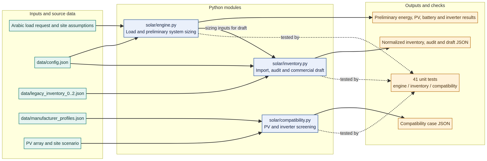

# Smart Solar Sizing v3.2 — فحص توافق PV بالمصادر


> الصورة تصورية للتوضيح فقط؛ ليست مخطط توصيلات ولا صورة لتركيب معتمد.

## التشغيل

```bash
python -m unittest discover -s tests -v
python run_compatibility_demo.py
```

Python 3.9+؛ مكتبات قياسية فقط. في Colab استخدم `02_Compatibility_Colab.ipynb`. سيحفظ مجلدًا جديدًا ولا يغير نسخ التطوير السابقة.

## نطاق هذه المرحلة

أضيفت ملفات مرجعية لموديلات دقيقة من الشركات، مع إصدار النشرة والحقول الغائبة. لا تُلحق هذه الملفات تلقائيًا بعناصر المخزون العامة. اسم Jinko 585W أو Growatt 5000W وحده لا يثبت تطابق الجهاز الفعلي مع إصدار المستند.

المرجع الشمسي JKM585N-72HL4-BDV، نشرة F9-EN؛ الإنفرتران SPF 5000 ES نشرة 2509، وSUN-8K-SG01LP1-EU نشرة 240802. انظر روابط الشركات في `data/manufacturer_profiles.json`. تمت قراءة جداول PDF بصريًا. لم تُنسخ الملفات الأصلية ضمن الحزمة.

## النتائج التي يجب فهمها

- مرجع Growatt المحدد يفرض حدًا لكل سلسلة غير حد MPPT الكلي. اللوح المختار يتجاوز حد السلسلة في هذا المرجع، فيرفض الزوج. لا يعمم ذلك على كل إصدارات العائلة.
- مرجع Deye يسمح بدراسة توزيع الألواح على مدخلين. اختيار 5 ألواح في سلسلة لكل مدخل يعطي 10 ألواح/5850W في السيناريو. التوزيع على مدخل واحد له نتيجة مختلفة.
- قيمة Isc الموثقة لهذا الإصدار من Deye هي 34A لكل MPPT. لم نخلطها مع 44A في مراجع أخرى.
- معامل Vmp الحراري غير منشور في نشرة اللوح المستخدمة. يظل الفحص الحراري pending. عند إدخال -0.003 كافتراض صريح فقط، تظهر النتيجة assumed_pass لا إثباتًا مصنعيًا.
- الارتفاع وحرارة الهواء قابلان للفحص؛ سيناريو 2300m يُرفض لمرجع Deye الذي يحدد 2000m. لم يُفترض أن مواقع اليمن كلها ضمن المجال.

## السيناريو والافتراضات

الخلايا من 0 إلى 70°C، ارتفاع توضيحي 1000m وحرارة هواء 40°C؛ هذه ليست بيانات مناخ معتمدة لمدينة محددة. استُخدمت زيادة تيار خلفي 10% ومعامل تيار قصر 1.25 كمدخلات حساسية صريحة، لا ثوابت إنتاج سنوي أو قاعدة عامة. استُخدم alpha Isc لتقدير حراري تقريبي لـImp، ولذلك يبقى نموذج التيار مشروطًا. حساب القدرة الاسمية يستخدم STC أمامي؛ لم نحاكِ زيادة القدرة الخلفية أو تشغيل اليوم ساعة بساعة.

## الملفات

- `solar/compatibility.py`: فحص الجهد والتيار لكل MPPT وحد السلسلة عند نشره، وعدد السلاسل والقدرة والبيئة؛ يسجل pass/fail/pending/assumed_pass لكل فحص.
- `data/manufacturer_profiles.json`: القيم المنشورة ومراجعها وإصداراتها والحقول الناقصة.
- `run_compatibility_demo.py`: اختبارات أمثلة مع ملفات JSON تفسيرية.
- `outputs/compatibility_cases.json`: نتائج قابلة للفحص، دون تسعير مفترض للموديل الدقيق.
- `tests/test_compatibility.py`: 12 اختبارًا جديدًا؛ المجموع 41 مع الاختبارات السابقة.
- `README_v3_1_history.md`: تفاصيل المرحلة السابقة، محفوظة للسياق.

## مخطط المعمارية



مصدر المخطط القابل للتحرير: [`docs/project-architecture.mmd`](docs/project-architecture.mmd).

## الحدود

هذه طبقة فحص PV فقط؛ ليست اعتماد تركيب منظومة كاملة. لم يتم اختيار البطارية أو إثبات BMS أو التحقق من أحمال AC والإقلاع والكابلات والقواطع والتأريض والتهوية والحد الأدنى لحرارة هواء الإنفرتر. معاملات الموقع والإشعاع والإصدارات الفعلية تحتاج تأكيدًا. لا توجد نتيجة installation_approved=true في هذا الإصدار.

المخزون القديم لم يصبح موثقًا بسبب إضافة مراجع الشركات، ومسودات التكلفة السابقة تبقى تجارية أولية. لا تُستبدل صفوف المخزون أو أسعارها تلقائيًا بالمرجع الجديد.

## مراجع الشركات

- [Jinko F9-EN](https://www.jinkosolar.com/uploads/JKM575-600N-72HL4-BDV-F9-EN.pdf)
- [Growatt 2509](https://en.growatt.com/upload/file/SPF_3500-5000%20ES_Datasheet-2509.pdf)
- [Deye 240802](https://www.deyeinverter.com/deyeinverter/2024/08/02/datasheet_sun-7.6-8k-sg01lp1-eu_240802_en.pdf)

التالي: تأكيد موديلات وإصدارات المعدات المستهدفة ومعامل Vmp الحراري/نموذج اللوح، ثم إدخال مواصفات البطارية وفحوص الأحمال لتكوين مسار منظومة مكتمل قبل Flutter.
